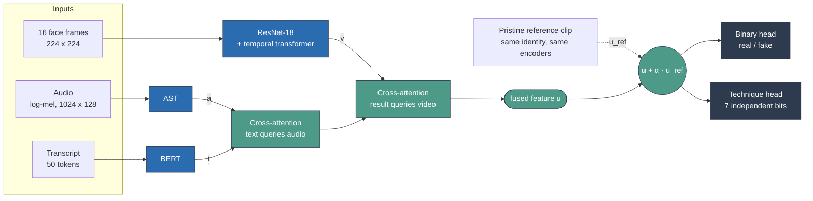
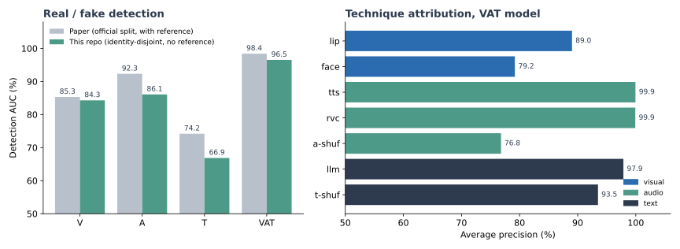

<div align="center">

# R-MFDN Reproduction on IDForge

**A from-scratch reimplementation of the Reference-assisted Multimodal Forgery Detection Network**<br>
(Xu et al., *Identity-Driven Multimedia Forgery Detection via Reference Assistance*, ACM MM 2024)


[Quick start](#quick-start) · [Results](#results) · [Train on IDForge](#train-on-idforge) · [What differs from the paper](#what-differs-from-the-paper) · [Repository layout](#repository-layout)

</div>

---

## What this is

R-MFDN decides whether a talking-head clip is real or forged from three streams
at once: the **video** frames, the **audio** track and the **transcript**. It can
also compare the clip with a pristine *reference* clip of the same person. The
authors released the IDForge dataset but no training code, so this repository
rebuilds the model, the training loop and the evaluation from the paper.

| | |
|---|---|
| **Task** | Binary real / fake detection, plus multi-label attribution of seven manipulation techniques |
| **Dataset** | [IDForge](https://github.com/xyyandxyy/IDForge) (54 identities, 11 forgery types), requested from the authors |
| **Model** | ResNet-18 + temporal transformer (video), AST (audio), BERT (text), progressive cross-attention fusion |
| **Runs anywhere** | One Docker image. Unit tests and an end-to-end check need no dataset and no GPU |

## Architecture



Training minimises four terms: cross-entropy on the binary head, binary
cross-entropy on the technique head, a cross-modal contrastive loss (paper
Eq. 4, weight β = 0.2) and an identity-aware contrastive loss against the
reference clip (Eq. 5, weight γ = 0.2). The reference is added to the fused
feature with α = 0.001 (Eq. 6).

## Quick start

The only requirement is [Docker](https://docs.docker.com/get-docker/). The
commands are the same on Linux, macOS and Windows.

```bash
git clone https://github.com/gocenalper/RMFDN-Reproduction.git
cd RMFDN-Reproduction

docker compose run --rm test      # 1. unit tests
docker compose run --rm smoke     # 2. end-to-end run on synthetic clips
docker compose run --rm results   # 3. print the results tables below
```

The first command builds the CPU image (about five minutes). No dataset, GPU or
model download is involved in any of the three.

**What the smoke test proves.** It writes 48 synthetic clips in the IDForge
directory layout, trains three cells for two optimizer steps each (all three
modalities with the identity reference, video + audio, text only), saves
checkpoints, scores the test split, then reloads every checkpoint through the
evaluation script and checks that the scores match. It uses small randomly
initialised encoders so it finishes in about a minute; the numbers it prints are
meaningless by design. Add `--pretrained` to run the same check with the real
ResNet-18, AST and BERT weights (roughly 1 GB download, cached in a Docker volume):

```bash
docker compose run --rm smoke python scripts/smoke_test.py --pretrained
```

<details>
<summary><b>Without Docker</b></summary>

```bash
python -m venv .venv
source .venv/bin/activate            # Windows: .venv\Scripts\activate
pip install torch==2.8.0 torchaudio==2.8.0
pip install -e ".[dev]"

python -m pytest -q
python scripts/smoke_test.py
```

</details>

## Results

<p align="center">
  
</p>

All numbers below are test-set scores from the files in [`results/`](results),
printed by `scripts/summarize_results.py`. Nothing in the tables is typed by hand.

**Setting of these runs:** identity-disjoint split (fold 0: 34 train, 6
validation and 14 test identities, [`protocol_p2/fold_F0.json`](protocol_p2/fold_F0.json)),
identity reference off, 6,000 optimizer steps at effective batch 128 on one GPU,
seed 0, best checkpoint chosen by validation AUC.

### Detection (real / fake)

| Modalities | Paper ACC | Paper AUC | This repo ACC | This repo AUC | Train time |
|---|---:|---:|---:|---:|---:|
| Video | 75.48 | 85.31 | 73.60 | 84.29 | 43 min |
| Audio | 81.31 | 92.31 | 65.02 | 86.06 | 114 min |
| Text | 67.94 | 74.19 | 63.45 | 66.86 | 6 min |
| **Video + Audio + Text** | **92.90** | **98.40** | **87.16** | **96.52** | 328 min |

Paper numbers are from Tables 2 and 3 of arXiv:2401.11764v3. **The two sides
are not a like-for-like comparison**: the paper trains for 90,000 iterations on
the official split with the identity reference, while these runs use 6,000
steps, no reference and test identities that never appear in training. See
[What differs from the paper](#what-differs-from-the-paper).

What the comparison does show: the reimplementation reaches the published AUC
regime with 1/15 of the training steps, the ordering of the modalities matches
(full model > audio ≈ video > text), and fusing the three streams gains about
10 AUC points over the best single stream, as in the paper.

### Technique attribution (average precision per technique)

| Run | lip-sync | face-swap | TTS | voice conv. | audio shuffle | LLM text | text shuffle | mAP |
|---|---:|---:|---:|---:|---:|---:|---:|---:|
| Video | 96.1 | 67.8 | – | – | – | – | – | 81.97 |
| Audio | – | – | 100.0 | 99.9 | – | – | – | 99.97 |
| Text | – | – | – | – | – | 91.6 | – | 91.60 |
| **Video + Audio + Text** | 89.0 | 79.2 | 99.9 | 99.9 | 76.8 | 97.9 | 93.5 | **90.89** |

A dash means the technique leaves no evidence in that stream (a voice clone
cannot be seen in the frames), so the run is neither trained nor scored on it.
For that reason the mAP column is not comparable across rows. The paper reports
mAP 93.38 for the full model over all seven techniques.

Full metrics (CF1, OF1, per-technique accuracy, precision and recall) and the
exact configuration of every run are in `results/fold0/<modality>/`.

## Train on IDForge

### 1. Get the data

Request IDForge from the authors (<https://github.com/xyyandxyy/IDForge>) and
arrange it like this. A directory counts as a clip when it holds a frame file.

```text
idforge/
├── train/ val/ test/
│   └── <forgery_type>/            pristine, face_tts, lip_rvc_textmismatch, ...
│       └── id07/.../<clip>/
│           ├── frames.jpz.npz     JPEG-encoded frames (or frames_ndarray.npy)
│           ├── <clip>.mp3         audio (mp3, wav or flac)
│           └── <clip>.txt         transcript
idforge_ref/
└── id07/.../<clip>/               pristine reference clips, same file layout
```

The eleven accepted `<forgery_type>` names and the techniques each one switches
on are listed in [`rmfdn_ablation/config.py`](rmfdn_ablation/config.py).

### 2. Train

```bash
# Linux / macOS
export IDFORGE_ROOT=/path/to/idforge
export IDFORGE_REFERENCE=/path/to/idforge_ref
export RMFDN_OUTPUT=./suite_out

docker compose run --rm train
```

On Windows PowerShell use `$env:IDFORGE_ROOT = "D:\idforge"` and so on. The
`train` service builds the CUDA image and needs an NVIDIA GPU with the
[NVIDIA Container Toolkit](https://docs.nvidia.com/datacenter/cloud-native/container-toolkit/latest/install-guide.html).
It runs the recipe behind the results above; the full model needs about 24 GB
of GPU memory at batch size 64.

`experiments/experiment_matrix.json` declares 13 cells. To train only some,
write a smaller config and point `RMFDN_CONFIG` at it:

```json
{"cells": [{"cross_modal": "m1", "identity": "i3", "protocol": "p2", "modalities": ["VAT"]}]}
```

| Field | Values |
|---|---|
| `identity` | `i1` identity reference on, `i3` reference off |
| `protocol` | `p1` official IDForge split, `p2` identity-disjoint split (`--p2-split`) |
| `modalities` | any of `V` `A` `T` `VA` `VT` `AT` `VAT` |

A run is named `m1_<identity>_<protocol>_<modalities>`. Training is resumable:
finished cells are skipped, and an interrupted cell continues from its last
checkpoint (written every 500 steps).

<details>
<summary><b>The underlying command and its options</b></summary>

```bash
python scripts/run_experiment_suite.py \
  --config experiments/experiment_matrix.json \
  --data-root /data/idforge --reference-root /data/idforge_ref \
  --p2-split protocol_p2/fold_F0.json \
  --output-dir /out \
  --iters 6000 --lr-schedule-iters 90000 \
  --eval-interval 1500 --patience 8 \
  --batch-size 64 --grad-accum-steps 2 --num-workers 8 \
  --mask-invisible-bits --skip-test-eval
```

| Option | Meaning |
|---|---|
| `--iters` / `--lr-schedule-iters` | Steps to run / length of the cosine schedule. The paper uses 90,000 for both |
| `--batch-size` × `--grad-accum-steps` | Effective batch size (64 × 2 = 128) at the memory cost of one micro-batch |
| `--mask-invisible-bits` | Supervise each cell only on techniques its modalities can observe |
| `--blank-modalities at` | Keep the full model but feed silence and an empty transcript (missing-modality tests) |
| `--select-metric {AUC,ACC,mAP}` | Validation metric that picks the best checkpoint (default AUC) |
| `--final-eval` | Also validate and save the weights of the last step |
| `--seed` | Training seed (default 0) |
| `--list` | Print the expanded run list and exit |

Outside Docker, `--bert-model` and `--ast-checkpoint` accept local directories
for machines without internet access.

</details>

### 3. Evaluate

```bash
docker compose run --rm eval      # writes $RMFDN_OUTPUT/test_results.json
```

This reloads each cell's best-validation checkpoint with the configuration it
was trained with and scores the whole test split: ACC and AUC for detection,
mAP, CF1 and OF1 plus per-technique accuracy for attribution. To add your runs
to the tables, copy `results.json` and `test_results.json` into
`results/<group>/<name>/` and run `docker compose run --rm results`.

<details>
<summary><b>On a Slurm cluster</b></summary>

Convert the image once (`apptainer build rmfdn.sif docker-daemon://rmfdn:gpu`)
and submit [`scripts/slurm/train_cell.slurm`](scripts/slurm/train_cell.slurm),
which trains one cell and evaluates it:

```bash
sbatch --account=<account> --export=ALL,MOD=VAT,WORK=/path/to/workdir scripts/slurm/train_cell.slurm
```

</details>

## What differs from the paper

| | Paper | This repository (reported runs) |
|---|---|---|
| Split | Official IDForge split | Identity-disjoint split, test identities unseen in training |
| Identity reference | On | Off (`i3`). The reference path is implemented (`i1`) and covered by the smoke test |
| Training length | 90,000 iterations, 8 × RTX 4090 | 6,000 steps, one GPU |
| Visual backbone | "Image model" (not named) + transformer | ImageNet ResNet-18 + 2-layer transformer over 4 groups of 4 frames |
| Audio / text encoders | AST-style transformer / BERT | AudioSet-pretrained AST / `bert-base-uncased`, both fine-tuned |
| Fusion input | Not specified | One pooled token per modality |
| Technique loss | Not specified in detail | Per-technique BCE, restricted to observable techniques |
| Seeds | Not reported | One seed per cell |

Two consequences are worth stating plainly. First, with one token per modality
the fusion's attention has a single key to attend to, so its weights are always
1 and the fused feature is a fixed mix of the streams; this is a property of
this reimplementation and may not hold for the authors' model. Second, every
reported number comes from a single seed, so differences of a point or two
between cells should not be read as significant.

## Repository layout

```text
rmfdn_ablation/            the package
├── config.py              technique taxonomy and paper hyper-parameters
├── data_catalog.py        clip discovery and labels from the directory names
├── media_io.py            frame, audio and transcript loading
├── dataset.py             dataset and batch collation
├── encoders.py            visual, audio and text encoders
├── RMFDN.py               the model: encoders, progressive fusion, two heads
├── losses.py              cross-modal and identity-aware contrastive losses
├── reference.py           identity-reference path
├── protocols.py           official and identity-disjoint splits
├── trainer.py             one training run: schedule, AMP, checkpoints, early stop
├── evaluation.py          detection and attribution metrics
└── experiment.py          experiment matrix expansion and sequencing
scripts/
├── run_experiment_suite.py   train the cells of a matrix
├── run_test_eval.py          score trained checkpoints on the test split
├── smoke_test.py             end-to-end check on synthetic clips
├── summarize_results.py      results tables and figure
└── slurm/train_cell.slurm    cluster recipe
experiments/experiment_matrix.json   the declared cells
protocol_p2/               identity-disjoint split files and their generator
results/                   stored metrics and configurations of the reported runs
tests/                     unit tests
Dockerfile, compose.yaml   container setup
```

## Reference

```bibtex
@inproceedings{xu2024identity,
  title     = {Identity-Driven Multimedia Forgery Detection via Reference Assistance},
  author    = {Xu, Junhao and Chen, Jingjing and Song, Xue and Han, Feng and Shan, Haijun and Jiang, Yu-Gang},
  booktitle = {Proceedings of the 32nd ACM International Conference on Multimedia},
  year      = {2024}
}
```

This repository is an independent reproduction for the YZM 5110 Multimodal
Learning course at Yıldız Technical University. It is not affiliated with the
authors of the paper, and it does not redistribute the IDForge dataset.
